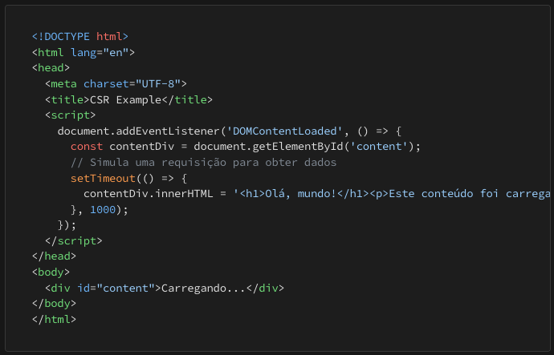
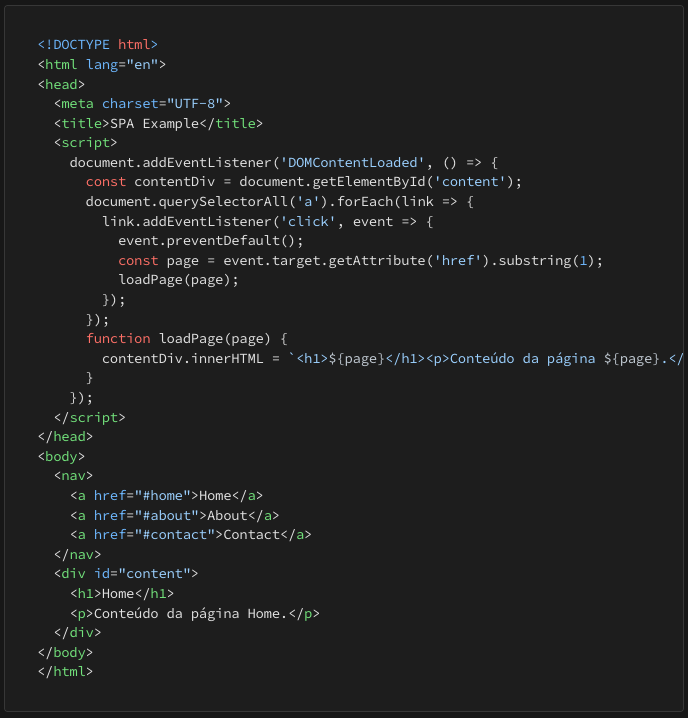
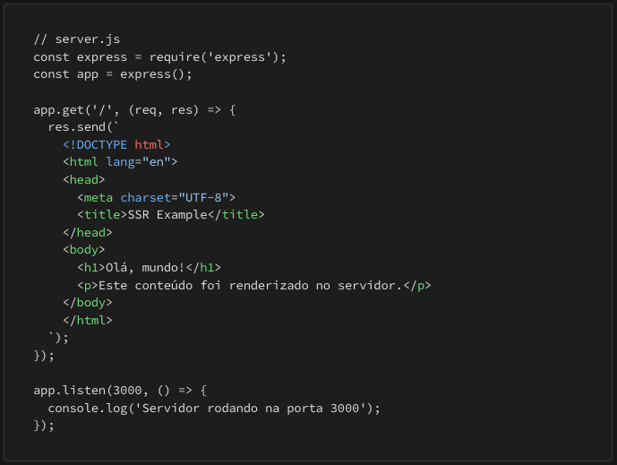
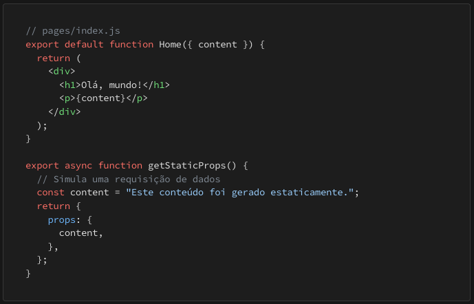
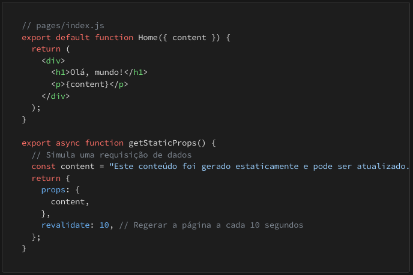

# NextJS modos de renderização 

## CSR - Client Side Rendering
Aqui a renderização é feita no lado do cliente, onde é feito o download de um HTML leve e um bundle pesado em JS, e depois de carregado o uso é super rápido.

Vantagens: Depois de baixado e carregado o sistema roda com alta bem fluído.

Desvantagens: Download de arquivos pesados, e indexação de SEO ruim.

Usos: Sistemas administrativos, dashboard, intranet.

## SPA - Single Page Application
Neste modo de renderização ele usa CSR, ele roda no lado do cliente da mesma forma, mas aqui todo o sistema é executado na mesma página, os estados são manipulados dentro da mesma página podendo usar diversos componentes para executar todas as funções do sistema. Todo SPA é um CSR, mas nem todo CSR é um SPA.

Vantagens: Após carregamento a interação é instantanea.

Desvantagens: Download de arquivos pesados, e indexação de SEO ruim.

Usos: Sistemas administrativos, dashboard, intranet.

## SSR - Server Side Rendering
Neste metódo de renderização o servidor trata de renderizar, e enviar para o navegador exibir, o servidor fica com todo trabalho pesado, mas os dados ficam expostos mais facilmente nos servidores e indexados nos sistemas de busca.

Vantagem: Muito bom para SEO, e deixa o navegador com menos responsabilidades.

Desvantagem: Exige muito do servidor, aumentando o custo com servidores, e se executar queries em banco existe a possibilidade de lentidão.

** os métodos de renderização que são executados no server side usam: getServerSideProps

## SSG - Static Site Generation 
Neste método de renderização é uma volta aos tempos antigos onde os sites eram estáticos, e quando os conteúdos precisavam ser atualizados, era necessário alterar os arquivos e upload do arquivo atualizado (antiga forma de buildar).

Vantagem: Excelente para SEO, simplicidade em desenvolver e servir.

Desvantagem: Manutenção comprometida em caso de muitas atualizações.

** os métodos de renderização que são STATIC usam: getStaticProps

## ISR - Incremental Static Regeneration
É o SSR com recurso de atualização (regeneration - rebuild) em um intervalo de tempo determinado no código (revalidate).

Vantagem: Excelente para SEO, e atualizaçào fácil.

Desvantagem: Precisa saber se o servidor suporta o recurso do revalidate.

** os métodos de renderização que são STATIC usam: getStaticProps

